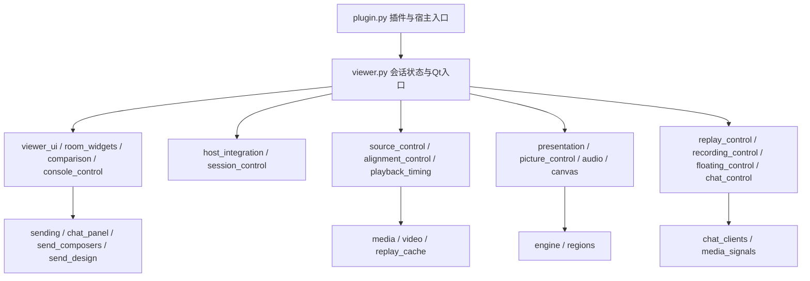

# 比赛二路同步：模块职责与生命周期

结构拆分基线`1dc6993`不调整画质、缓冲、时序、信号连接或线程策略。结构拆分本身不代表实播性能提升。
2026-11-10的独立功能修复取消主路强制最高档：主路选择保留当前画质，默认取流交给平台，手动档位保持；副路画中画的既有均衡策略保留。

## 状态与依赖边界

| 模块 | 职责与状态所有者 |
| --- | --- |
| `viewer.py` | Viewer唯一持有房间集合、来源引用、同步/回看/录制/浮层会话状态；初始化既有模型和运行接线，保留原签名、Slot、staticmethod及Qt回调。保存偏好仍在此协调。高频eventFilter完整保留在Qt对象上，避免额外Python边界影响Qt借用对象的包装；它调用所属模块的快捷键及布局助手 |
| `viewer_ui.py` | 按原顺序构建控件、布局、连接与外观；控件引用仍存于Viewer，不创建第二份界面或业务状态 |
| `room_widgets.py` / `comparison.py` | 完整RoomRow/CompactStatus与ComparisonPanel组件。RoomRow拥有每路状态、解码器/弹幕客户端引用及画质快照；ComparisonPanel拥有其卡片。父对象保持原样 |
| `console_control.py` | 控制台展开/收起、尺寸适配、房间排序/拖动及通知定位；使用Viewer原有布局状态及动画集合 |
| `host_integration.py` / `session_control.py` | 宿主嵌入、快捷键、侧栏标记、宿主音频暂停/恢复；会话启动、停止、关闭/拒绝及收尾。Qt override仍由原Viewer接收；show/hide/close/reject向模块传入原绑定基类回调，保持调用顺序 |
| `source_control.py` / `room_input.py` | 来源增删/撤销、启动/停止和有效回调门控；房间输入校验。来源对象继续由原RoomRow引用，不复制解码状态 |
| `alignment_control.py` / `playback_timing.py` | 匹配任务、结果门控、确认/应用偏移、独立播放和同步健康；时钟/缓存恢复、余量政策及提醒。Results信号类完整迁移，算法仍在engine/regions |
| `presentation.py` / `picture_control.py` | 逐轮画面/弹幕/回看投递及帧预算；主路选择、画质/设置、暂停、全屏和流信息。调度状态仍归Viewer，未增加定时器或线程 |
| `canvas.py` / `audio.py` | Canvas拥有显示帧、绘制和鼠标手势；AudioPump拥有输出时钟、快照/锁/游标，AudioFeed拥有音频设备和线程定时器 |
| `chat_control.py` / `chat_panel.py` | 弹幕客户端与会话协调、状态和滚动层；完整SendingDanmakuPanel负责列表、回看分隔与消息点击展示。列表仍是原Viewer使用的同一组件 |
| `sending.py` / `send_composers.py` / `send_design.py` | SendConsole拥有目标、草稿、暂存文本及发送反馈；SendRow包装宿主原生输入控件，BatchSend拥有队列和50ms定时器；样式/绘制已有模块保持。没有新增发送路径或读取账号 |
| `media.py` / `video.py` / `replay_cache.py` | 媒体地址获取、捕获、解码、历史缓存、异步RGB准备及磁盘缓存。Decoder完整保留；画布消费已准备帧 |
| `chat_clients.py` / `media_signals.py` | 完整Chat/PlatformChat负责弹幕协议与取消/重连；Events为解码器和弹幕共用的单一信号契约。聊天模块不反向依赖Decoder或Viewer |
| `engine.py` / `regions.py` | 无GUI/网络的匹配、缓冲、音频路由、重采样与混音算法；本轮不改写或复制 |
| `replay.py` / `replay_preview.py` / `preview_frames.py` | 时间线、拖动预览和后台缩图；原有状态与生命周期保持 |
| `recording.py` / `floating.py` / `upscale.py` / `fullscreen.py` | 录制执行、裁切窗口、可选增强和系统全屏标记；对应会话操作移入职责模块，底层实现保持 |
| `panels.py` / `diagnostics.py` | 通用控制台控件与设置；既有诊断及指标。保留当前内聚边界，不为减少行数进一步拆散 |

业务协调模块是显式接收Viewer的函数，不是新的QObject或状态容器。只访问原状态，不在模块间维护镜像。组件通过原Viewer方法回调；实现模块不反向导入Viewer，避免循环依赖。Qt父对象、信号接收者、定时器/异步回调所有者均未更换。

## 音频和聊天收尾

1. AudioPump仍以Viewer为QObject父对象。GUI的10ms快照刷新保留；AudioFeed无父对象，移入原QThread后创建QAudioSink与10ms PreciseTimer。
2. 音频stop先停GUI定时器，经BlockingQueuedConnection停止Feed设备，再quit/wait线程，沿用原deleteLater连接释放对象。时钟、回看偏移、独立播放及声道保持。
3. Chat继续使用可取消Python线程/asyncio任务；stop仍通过原loop取消task。PlatformChat保持宿主客户端的QObject父对象、finished信号及原2000ms等待/延后删除语义。
4. BatchSend继续按50ms推进原生输入组件，停止/移除目标时沿用原shutdown。没有额外直播连接、媒体解码或真实自动发送。

## 兼容与验证

`viewer`保留Canvas、AudioFeed/AudioPump、RoomRow/CompactStatus、ComparisonPanel、Results、parse_room、picture_poll_interval/cache_gap及既有检查使用的导出；`sending`保留SendingDanmakuPanel/SendRow/BatchSend，`media`保留Events/Chat/PlatformChat。它们都是所属模块的同一个对象，项目内部直接依赖实现所属模块；依赖替身也patch实际模块。

拆分基线`1dc6993`对起点源码执行118个Viewer方法的AST核对：展开UI构建，归一化接收者名、等值日志类别和绑定基类调用后，逻辑及顺序一致；15个完整类的AST一致。模块边界及专项检查覆盖控件父对象、定时参数、真实QThread中的替身音频设备、聊天取消/信号转发/收尾、发送草稿/批量取消、布局、全屏、裁切、同步/缓冲和回看预览。每批集成安装副本，并从根run.cmd隔离复测，禁网、空配置、真实发送0。

完整replay专项的既有像素断言`Ruler backing must blend with the picture`在拆分前后均失败，保留断言，不算通过；其他回看音频、独立播放和预览专项单独覆盖。隐藏Windows检查使用虚拟鼠标坐标；CSS断言检查原始样式及等价空白，不修改产品样式。功能回归不能代替真实直播流畅度和音质验收。

## 本轮停止边界

Viewer保留会话聚合状态、运行接线、保存协调和Qt入口；RoomRow、SendConsole、匹配流程、媒体解码与算法模块分别围绕一个完整对象或流程内聚。继续拆散其内部方法会增加跨模块状态访问与生命周期耦合，目前没有必要。后续应依据实际修改需求或实测热点继续细分，不设机械行数目标。
